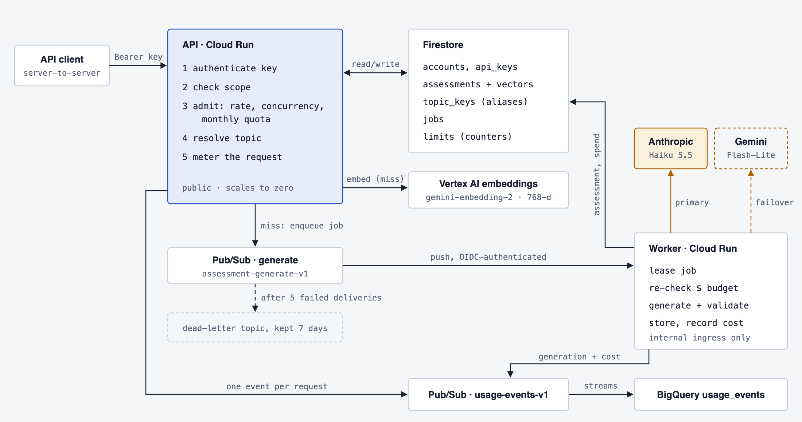

# Synapset

Generates multiple-choice knowledge assessments for any topic, once. An assessment is created by an LLM the first time a topic is requested, stored in Firestore with an expiry, and served from the cache to every later request for the same or a semantically similar topic, so repeat requests spend no LLM tokens.

## How it works

Diagrams of the full architecture (request path, topic resolution, job lifecycle, limits, edge, delivery): [docs/architecture](docs/architecture/README.md).



```
Client ─▶ api (Cloud Run, public)
           1. in-memory LRU → 2. exact key (Firestore) → 3. alias → 4. embed + findNearest (COSINE)
           hit  → 200 with the assessment
           miss → claim jobs/{key} (transaction) → publish once → 202 + Location: /v1/jobs/{key}
                      │
                      ▼ Pub/Sub push (OIDC, backoff, dead-letter after 5 attempts)
         worker (Cloud Run, internal) → lease job → LLM → validate → store assessment + vector
```

- **Cache key:** sha256 of the normalized topic, context, style and reuse mode plus its scope (locale, style, questions per level, prompt version, embedding model). Changing any of these produces new assessments; changing the LLM does not.
- **Semantic match:** cosine similarity ≥ `SIMILARITY_THRESHOLD` (0.88) within the same scope. A match is saved as an alias, so the next identical request is an exact hit.
- **Expiry:** `expiresAt` is checked on every read; an expired assessment is regenerated in full. Firestore TTL deletes old documents later (typically within 24 hours).
- **Deduplication:** concurrent misses share one job; the worker's lease and idempotent writes make Pub/Sub redeliveries harmless.
- **Question bank:** every checked question is stored on its own (Firestore `questions`) with an embedding of its text and correct answer. On a miss, the API embeds topic + context once and searches the bank for each difficulty level. A question is reused if its similarity exceeds the request's noise floor (its similarity to a fixed set of unrelated questions) by `QUESTION_REUSE_MARGIN` (0.08). Near-duplicates and quarantined questions are skipped. If every level is covered, the assessment is composed with no LLM call and no generation charged. Otherwise the worker generates only the missing questions, tells the model which ones exist, and drops any new one that duplicates them. Bank entries are partitioned by locale, style, prompt version and embedding model, so a question is only reused where it was written for the same audience. Callers choose `reuse`: `auto` (default), `strict` (`QUESTION_REUSE_STRICT_MARGIN`, 0.12) or `off` (always generate, no semantic match). Reuse fails open: search errors fall back to generation. `REUSE_QUESTIONS=false` disables it service-wide.
- **Calibration:** `pnpm admin calibrate` embeds a labelled set (`apps/admin/calibration.json`: requests with related and close-but-unrelated questions) using the live embedding model and the bank's own floor rule, then prints precision and recall per margin and the misjudged pairs. On gemini-embedding-2 the bundled set gives 97% precision / 91% recall at 0.08 and 100% / 62% at 0.12. Rerun it after changing the embedding model, and extend the set with real requests.
- **Context and style:** optional caller guidance. `context` (up to 1000 characters) says what to cover; it is part of the cache key and of the embedded request text used to find related questions. `style` (up to 300 characters) says how to write: audience, tone, format, such as "for 10-year-olds" or "scenario-based questions for nurses". It is part of the cache key and the bank scope (normalised, so casing and punctuation don't matter) but not of the embedding. Both are passed to the generator inside tags as guidance that can't override the rules.
- **Feedback loop:** `POST /v1/assessments/{id}/feedback` reports a bad question (`wrong_answer`, `ambiguous`, `off_topic`, `outdated`, `other`). Each account can report a question once. When `FEEDBACK_QUARANTINE_REPORTS` (2) distinct accounts have reported it, the question is quarantined: never reused, blocked if the model writes the same text again, and every assessment containing it is expired, so the next request rebuilds it (reusing the rest from the bank) without it. Reports keep whether the question was reused, so `pnpm admin feedback summary` shows if `off_topic` reports concentrate on reused questions, a sign the margin is too loose. Operators can `question quarantine` or, after review, `question restore` (which dismisses the reports so they stop counting).
- **Question count:** every topic is generated once with `QUESTIONS_PER_LEVEL` questions per level (default 10, max 20). Callers pass `questionsPerLevel` to receive the first N per level of the same cached assessment, so the count never multiplies generations.
- **Question pools:** `POST /v1/pools/next` serves slices of a long-lived pool. A pool is one topic for one language, audience, tone and set of question types, kept per difficulty, so neither children's questions nor another language's ever use up the room adults' need. Pool languages are a fixed list (`POOL_LANGUAGES`), and stored questions carry their language, audience, tone and type as labels. Consumers hold a cursor; the service keeps nothing about them. A slice is stored as an ordinary assessment under an id derived from its content, so a repeated request costs one read and grading, reporting and quarantine work unchanged. When a slice needs questions the pool lacks, relevant questions are taken from the bank (`strict` margin) and only the remainder is generated, in small chunks of `QUESTION_POOL_BATCH_PER_LEVEL` per level. A pool grows only as cursors reach its end, never to its cap up front. The model is given the concepts the pool covers, and anything that repeats one, by text, meaning or concept label, is dropped. A level yielding under half of what it asked for is saturated for 30 days instead of paying for repeats. Past a pool's limit, slices are drawn at random. Pool keys and bank scopes leave the prompt version out, so a prompt change does not orphan years of questions.
- **Pool lifetime and caps:** questions live for `QUESTION_POOL_TTL_SECONDS` (two years); no request can change that. `QUESTION_POOL_CAP` (300) is the default ceiling per topic, language, audience, tone and difficulty. `pnpm admin pool-cap set --cap <n>` overrides it by any of those dimensions, live within 30 seconds, without a deploy. Lowering a cap stops serving and generating past it; it deletes nothing.
- **Answer check:** with `VERIFY_ANSWERS=true` (default), the worker generates about 25% spare questions, has the model answer each one blind, and keeps only those whose key it confirms and judges unambiguous. Questions that pass are kept, and a second round asks only for what's still missing; still short after that fails the attempt, and Pub/Sub retries it. The check adds roughly 30–40% to generation cost.
- **Answers stay server-side:** questions are returned without `a`/`e`; the grade endpoint scores answers and then reveals them.

## LLM providers

| Role                  | Default                                                           | Switch                                                |
| --------------------- | ----------------------------------------------------------------- | ----------------------------------------------------- |
| Generation (primary)  | Claude via the Anthropic API, `claude-haiku-5-5`, effort `medium` | `LLM_PROVIDER`, `ANTHROPIC_MODEL`, `ANTHROPIC_EFFORT` |
| Generation (fallback) | Gemini on Vertex AI, `gemini-3.5-flash-lite`                      | `LLM_FALLBACK_PROVIDER` (`none` disables)             |
| Embeddings            | `gemini-embedding-2`, 768 dimensions, normalized                  | `EMBEDDING_MODEL`                                     |

When the Anthropic API reports billing, authentication or permission errors (for example, exhausted credits), the worker logs an error and serves from the fallback for 5 minutes before probing Anthropic again. To move to Gemini permanently, set `LLM_PROVIDER=gemini`. Cached assessments stay valid either way.

Options are shuffled server-side after generation, so the position of the correct answer carries no signal.

## API

Integration guide for API consumers (quickstart, endpoints, errors, limits, client examples): [docs/api.md](docs/api.md). Interactive reference: `/docs` ([Scalar](https://github.com/scalar/scalar), self-hosted: the page loads nothing from third-party origins). Machine-readable contract: `GET /openapi.json` (OpenAPI 3, generated from the same Zod schemas that validate requests and responses).

### Authentication

Every `/v1` route takes an API key as `Authorization: Bearer synapset_sk_<keyId>_<secret>`. Keys belong to an account, carry scopes (`assessments:read`, `assessments:write`, `assessments:grade`), can expire, and can be revoked. Only a SHA-256 hash is stored; the key is shown once at creation. The fixed `synapset_sk_` prefix lets GitHub and GitLab secret scanning detect leaked keys. Revocations, suspensions and plan changes take effect within 30 seconds.

Keys are for server-to-server use. Never ship one to a browser or mobile app; there is no CORS support by design.

```sh
pnpm admin account create --name "Acme" --plan pro     # prints acct_…
pnpm admin key create --account acct_… --name prod --scopes assessments:read,assessments:write --expires-days 365
pnpm admin key list --account acct_…
pnpm admin key revoke --key <keyId>
pnpm admin account plan --account acct_… --plan enterprise
pnpm admin account suspend --account acct_…
pnpm admin feedback list --limit 20                      # latest question reports
pnpm admin feedback summary                              # by reason, reused vs generated
pnpm admin question quarantine --question <id>           # or: question restore --question <id>
pnpm admin calibrate                                     # precision/recall per reuse margin
```

### Endpoints

| Method | Path                                                                                                                  | Scope   | Result                                                                                        |
| ------ | --------------------------------------------------------------------------------------------------------------------- | ------- | --------------------------------------------------------------------------------------------- |
| `POST` | `/v1/assessments` `{ "topic", "context"?, "style"?, "reuse"?, "locale"?: "en", "ttlSeconds"?, "questionsPerLevel"? }` | `write` | `200 { status: "ready", match: exact                                                          | semantic | composed, assessment }`or`202 { jobId, status }`with`Location`and`Retry-After` |
| `GET`  | `/v1/jobs/{jobId}`                                                                                                    | `read`  | `{ jobId, status, assessmentId, error }`                                                      |
| `GET`  | `/v1/assessments/{id}?questionsPerLevel=`                                                                             | `read`  | `{ id, topic, locale, questionsPerLevel, createdAt, expiresAt, questions: [{ i, q, o, d }] }` |
| `POST` | `/v1/assessments/{id}/grade` `{ "questionsPerLevel"?, "answers": [0-3 or null, ...] }`                                | `grade` | `{ score, total, results: [{ i, correct, a, e }] }`                                           |
| `POST` | `/v1/assessments/{id}/feedback` `{ "questionsPerLevel"?, "i", "reason", "comment"? }`                                 | `read`  | `202 { status: recorded \| duplicate, quarantined }`                                          |
| `GET`  | `/v1/usage`                                                                                                           | `read`  | Requests this month and generations today against the plan, plus rate limits                  |

Question keys: `q` question, `o` four options, `a` correct option index, `e` explanation, `d` difficulty (1 easy, 2 medium, 3 hard). Job `error` is `topic_rejected`, `generation_capacity_exhausted` or `generation_failed`.

Clients poll the job until it is `done` (honouring `Retry-After`), or simply repeat the `POST`, which returns `200` once the assessment exists.

Errors are [RFC 9457](https://www.rfc-editor.org/rfc/rfc9457) `application/problem+json` with a stable `code` and the `request_id` (also sent as `X-Request-Id`):

| Status | `code`                                                                                                                          |
| ------ | ------------------------------------------------------------------------------------------------------------------------------- |
| 400    | `invalid_request` (with `errors: [{ pointer, detail }]`), `bad_request`                                                         |
| 401    | `unauthorized` (with `WWW-Authenticate`)                                                                                        |
| 403    | `insufficient_scope`                                                                                                            |
| 404    | `not_found`                                                                                                                     |
| 413    | body over 16 KB                                                                                                                 |
| 415    | anything other than `application/json`                                                                                          |
| 429    | `rate_limited`, `too_many_concurrent_requests`, `request_quota_exceeded`, `generation_quota_exceeded`, `too_many_auth_failures` |
| 503    | `generation_capacity_exhausted`, `service_unavailable`                                                                          |

Every `429` and `503` carries `Retry-After`.

### Plans, limits and billing

| Plan         | Requests/min (burst) | Concurrent | Requests/month | New generations/day |
| ------------ | -------------------- | ---------- | -------------- | ------------------- |
| `free`       | 30 (10)              | 2          | 10,000         | 20                  |
| `pro`        | 300 (60)             | 10         | 1,000,000      | 1,000               |
| `enterprise` | 1,200 (200)          | 50         | 20,000,000     | 10,000              |

Plans live in `packages/core/src/billing.ts`. Per-account overrides go in the account document's `limitOverrides`.

- **Rate and concurrency.** Each account has a token bucket (GCRA), a concurrency semaphore and a monthly quota, all checked in one admission step. Where they are stored depends on the limit store (see [Cost profile](#cost-profile)). Responses carry `RateLimit-Limit`, `RateLimit-Remaining` and `RateLimit-Reset`. If the limit store is unreachable, requests are admitted, but generations are refused.
- **LLM spend.** Two independent controls apply:
  - Only a cache miss costs tokens, so each account has a daily new-generation quota.
  - A service-wide `LLM_DAILY_BUDGET_USD` caps total spend per UTC day.

  The worker prices every generation from its token usage (`MODEL_PRICES` in `billing.ts`; an unknown model is priced deliberately high) and adds the cost to the daily total. When the budget is reached, new generations get `503 generation_capacity_exhausted` until UTC midnight, while cached topics keep being served. The worker re-checks the budget before calling the LLM, so jobs already queued cannot overspend. The overshoot is bounded by the generations in flight. Also set a monthly spend limit in the Anthropic Console as a backstop.

- **Metering.** Every authenticated request (`api.request`) and every generation (`llm.generation`, with tokens and cost) is published to Pub/Sub. A BigQuery subscription streams it into the day-partitioned table `<env>_usage.usage_events`. Delivery is at-least-once, so deduplicate on `event_id`:

```sql
SELECT account_id,
       COUNTIF(event = 'api.request' AND status < 400) AS billable_requests,
       SUM(IF(event = 'llm.generation', cost_usd, 0)) AS llm_cost_usd
FROM (SELECT * FROM `PROJECT.synapset_prod_usage.usage_events`
      WHERE occurred_at >= TIMESTAMP_TRUNC(CURRENT_TIMESTAMP(), MONTH)
      QUALIFY ROW_NUMBER() OVER (PARTITION BY event_id) = 1)
GROUP BY account_id;
```

### Security (OWASP API Security Top 10, 2023)

| Risk                                        | Control                                                                                                                                                                                                                                                                            |
| ------------------------------------------- | ---------------------------------------------------------------------------------------------------------------------------------------------------------------------------------------------------------------------------------------------------------------------------------- |
| API1 Broken object level authorization      | Assessments are a shared, non-personal catalog by design (that is what makes caching across accounts possible). IDs are unguessable SHA-256 values. Account data is only reachable through the caller's own principal (`/v1/usage`).                                               |
| API2 Broken authentication                  | 256-bit random keys stored as hashes; Bearer only, never in URLs. Expiry, revocation and account suspension. Failed attempts are throttled per IP. `Authorization` is redacted from logs.                                                                                          |
| API3 Broken object property level auth      | Response schemas are allow-lists: the serializer drops every field it does not declare (answers, usage, provider details). Request bodies are strict, so unknown properties are a 400.                                                                                             |
| API4 Unrestricted resource consumption      | Per-account rate, concurrency and monthly quota; daily generation quota; global LLM budget; 16 KB bodies; 30 s timeouts; bounded topic and array sizes; Cloud Run max instances; Cloud Armor per-IP and per-key ceilings.                                                          |
| API5 Broken function level authorization    | Every route declares a scope; there are no admin endpoints over HTTP (administration is a CLI with direct IAM-controlled Firestore access).                                                                                                                                        |
| API6 Unrestricted access to sensitive flows | Paid generation is gated by quota and budget; only the caller who triggers a generation is charged.                                                                                                                                                                                |
| API7 Server-side request forgery            | The API never fetches user-supplied URLs.                                                                                                                                                                                                                                          |
| API8 Security misconfiguration              | `no-store`, `nosniff`, a CSP of `default-src 'none'`, `frame-ancestors 'none'`, HSTS, `Referrer-Policy` and CORP on every response. TLS 1.2+ MODERN policy at the load balancer. Problem responses never expose internals. JSON only, with prototype-poisoning rejection. No CORS. |
| API9 Improper inventory management          | One versioned surface (`/v1`) described by the generated OpenAPI document. The worker is internal-only. Infrastructure is fully in Terraform.                                                                                                                                      |
| API10 Unsafe consumption of APIs            | LLM output is constrained by JSON schema and then re-validated and normalised. The topic is escaped and delimited in the prompt. Provider errors are classified, never passed through.                                                                                             |

At the edge (when `api_domain` is set), a global external Application Load Balancer applies Cloud Armor:

- the OWASP ModSecurity CRS 3.3 preconfigured rules (SQLi, XSS, LFI, RFI, RCE, method enforcement, scanner detection, protocol attack, session fixation, Node.js), with JSON body parsing;
- adaptive Layer 7 DDoS protection;
- per-IP rate-based bans;
- a per-API-key ceiling.

Cloud Run ingress then accepts only the load balancer.

The WAF rules start in preview (`waf_preview = true`). Topics such as "SQL injection" or "XSS attacks" are legitimate inputs to this API and can match CRS signatures. Review `jsonPayload.enforcedSecurityPolicy` and `previewSecurityPolicy` in the load balancer logs, add exclusions for false positives, then set `waf_preview = false`.

## Development

Requires Node 24 (`nvm use`) and pnpm 10.

```sh
pnpm install
cp .env.example .env              # set GCP_PROJECT_ID; ANTHROPIC_API_KEY or `ant auth login`
gcloud auth application-default login
pnpm admin account create --name dev && pnpm admin key create --account <acct> --name local
pnpm dev:api                      # :8080
pnpm dev:worker                   # :8081
```

Without `REDIS_URL`, limits use Firestore (see [Cost profile](#cost-profile)). The limit-store integration tests run when their backends are available, as they are in CI:

```sh
gcloud emulators firestore start --host-port=127.0.0.1:8085 &   # needs Java 21+
docker run -d -p 6379:6379 redis:7.2-alpine
FIRESTORE_EMULATOR_HOST=127.0.0.1:8085 REDIS_URL=redis://localhost:6379 pnpm test
```

```sh
pnpm lint && pnpm typecheck && pnpm test
```

## Deployment

Step-by-step setup of a new environment, from an empty project to a verified deploy: [docs/setup.md](docs/setup.md).

Infrastructure lives in `infra/terraform`:

- Firestore with the vector and TTL configuration
- Pub/Sub with dead-lettering
- both Cloud Run services, with Direct VPC egress
- Memorystore Redis with AUTH and TLS (optional, via `redis_enabled`)
- the usage pipeline into BigQuery
- the load balancer and Cloud Armor (optional, via `api_domain`)
- alerts (optional, via `alert_email`) for budget exhaustion, provider failover, lost usage events, dead letters and 5xx
- a Cloud billing budget (optional, via `billing_account_id`)
- least-privilege service accounts, secrets, Artifact Registry, and Workload Identity Federation for GitHub Actions

The default deployment has no fixed monthly cost; see [Cost profile](#cost-profile).

```sh
cd infra/terraform
cp dev.tfvars.example dev.tfvars
terraform init -backend-config="bucket=<state-bucket>" -backend-config="prefix=dev"
terraform apply -var-file=dev.tfvars -target=google_secret_manager_secret.anthropic_api_key
printf '%s' "$ANTHROPIC_API_KEY" | gcloud secrets versions add synapset-dev-anthropic-api-key --data-file=-
terraform apply -var-file=dev.tfvars
# With api_domain set: point its DNS A record at the `api_ip` output; the certificate provisions once it resolves.
```

Then create a GitHub Environment per Terraform environment (`dev`, `prod`) holding its Terraform outputs as variables (see [docs/setup.md](docs/setup.md)). Every green CI run on `main` builds both images and deploys them to dev. Prod promotes the same image digests after a reviewer approves the `prod` environment.

## Cost profile

The default deployment costs **$0/month when idle**. Every component bills per use and scales to zero:

- Cloud Run, Pub/Sub, Firestore and BigQuery
- Vertex AI and Anthropic tokens

Free tiers cover low traffic. The only standing charges are cents for stored data: container images, BigQuery rows and Secret Manager versions beyond the free six.

Two optional components add fixed cost. Both are off by default, and each is a single Terraform variable:

| Component                   | Variable               | Fixed cost/month                                                        | Turn on when                                                                                      |
| --------------------------- | ---------------------- | ----------------------------------------------------------------------- | ------------------------------------------------------------------------------------------------- |
| Memorystore Redis (limits)  | `redis_enabled = true` | ~$36 (`BASIC`), ~$72 (`STANDARD_HA`)                                    | Any account sustains about 1 request/s, or you need exact per-minute rate limits across instances |
| Load balancer + Cloud Armor | `api_domain = "api.…"` | ~$18 forwarding rule + ~$5 policy + ~$1/rule (~$34), + $0.75/M requests | You need a custom domain, the OWASP WAF, or edge rate limiting and DDoS protection                |

Alerts (`alert_email`) and the billing budget (`billing_account_id`) are also off by default. Budgets are free; Cloud Monitoring may bill alert conditions at a few cents each.

`terraform output fixed_monthly_cost` shows the approximate fixed cost of what is enabled.

### Limits without Redis (default)

`FirestoreLimitStore` is used whenever `REDIS_URL` is unset:

| Limit                                    | Storage               | Accuracy                                                 |
| ---------------------------------------- | --------------------- | -------------------------------------------------------- |
| Daily LLM budget, daily generation quota | Firestore transaction | Exact across all instances                               |
| Monthly request quota                    | Firestore transaction | Exact across all instances                               |
| Requests/min, burst, concurrency         | Instance memory       | Per instance: with N instances, up to N× the limit       |
| Failed-auth throttle                     | Instance memory       | Per instance (so attackers never cause Firestore writes) |

So the controls that protect money stay exact. Only the per-minute smoothing is approximate, and it is still bounded by `api_max_instances`.

The cost is one Firestore transaction per request, about $0.25 per 100k requests. Each counter is a single document, which sustains roughly one write per second; past that, contended transactions retry and latency rises. That is the signal to enable Redis.

### Enabling Redis

```hcl
redis_enabled = true
redis_tier    = "BASIC"   # or STANDARD_HA for a replicated instance
```

`terraform apply` creates the VPC, the Memorystore instance (AUTH + TLS) and the `REDIS_URL` secret. It wires both Cloud Run services to them through Direct VPC egress. The services switch to `RedisLimitStore` on their next revision: one atomic Lua script per request, using Redis server time, exact across instances. No code changes. Counters start fresh in Redis, so quotas already used that day or month in Firestore are not carried over.

### Enabling the load balancer and Cloud Armor

```hcl
api_domain = "api.example.com"
```

Apply, then point the domain's DNS A record at `terraform output api_ip`. The managed certificate provisions once the record resolves. Cloud Run ingress then switches to load-balancer-only, so the WAF cannot be bypassed, and `TRUSTED_PROXY_HOPS` becomes 2. Start with `waf_preview = true` (see Security above).

Without the load balancer, the API is served on its `run.app` URL. It still has every in-app control (authentication, scopes, plan limits, quotas, the LLM budget, strict schemas, security headers) and Google's front-end DDoS protection. It lacks the WAF and edge rate limiting.

### Other zero-fixed-cost options

These are not implemented.

- **[Upstash](https://upstash.com) serverless Redis** (pay per command, with a free tier): set `REDIS_URL` to its `rediss://` URL and every limit becomes exact and shared, with no code changes. The trade-off is a third-party vendor reached over the public internet.
- **Cloudflare (free plan) in front of `run.app`**: gives a WAF and edge rate limiting without the Google load balancer. Cloud Run can't restrict ingress to Cloudflare, so the app would need to verify a secret header that Cloudflare injects.

## Configuration

Validated at startup by `packages/core/src/config.ts`; see `.env.example` for the full list. Keep `EMBEDDING_DIMENSIONS` (code) and the vector index dimension (Terraform) in sync, and bump `PROMPT_VERSION` whenever the prompt changes. A bump starts a new cache and a new bank partition: existing assessments stay valid until they expire but are no longer matched.

Question generation and reuse:

| Variable                        | Default | Meaning                                                                                                 |
| ------------------------------- | ------- | ------------------------------------------------------------------------------------------------------- |
| `QUESTIONS_PER_LEVEL`           | `10`    | Questions generated per difficulty level (max 20); callers can request fewer                            |
| `VERIFY_ANSWERS`                | `true`  | Blind second pass that discards questions whose key it doesn't confirm                                  |
| `REUSE_QUESTIONS`               | `true`  | Reuse bank questions across assessments                                                                 |
| `QUESTION_REUSE_MARGIN`         | `0.08`  | Similarity above the request's noise floor needed to reuse (`reuse: auto`); see `pnpm admin calibrate`  |
| `QUESTION_REUSE_STRICT_MARGIN`  | `0.12`  | The same for `reuse: strict`; must be ≥ the margin                                                      |
| `FEEDBACK_QUARANTINE_REPORTS`   | `2`     | Distinct accounts that must report a question before it is quarantined                                  |
| `QUESTION_POOL_TTL_SECONDS`     | 2 years | Lifetime of pool questions. Server-only: clients cannot set it                                          |
| `QUESTION_POOL_CAP`             | `300`   | Default cap per topic, language, audience, tone and difficulty; `pnpm admin pool-cap` overrides it live |
| `QUESTION_POOL_BATCH_PER_LEVEL` | `6`     | New questions written per level each time a pool runs out                                               |
