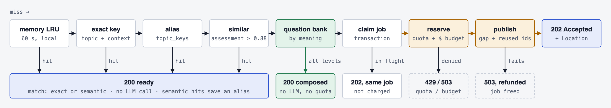

# Synapset API guide

Synapset turns a topic into a multiple-choice knowledge assessment with three difficulty levels, and grades the answers. This guide is for developers integrating the API. The interactive reference, where you can send test requests with your key, is at `/docs`. The machine-readable contract is the OpenAPI document at `GET /openapi.json`.

- [Quickstart](#quickstart)
- [How it works](#how-it-works)
- [Authentication](#authentication)
- [Endpoints](#endpoints)
- [Objects](#objects)
- [Errors](#errors)
- [Rate limits and quotas](#rate-limits-and-quotas)
- [Integration guide](#integration-guide)

## Base URL

| Environment | Base URL                                           |
| ----------- | -------------------------------------------------- |
| Dev         | `https://synapset-dev-api-cwsrlaqchq-uc.a.run.app` |
| Production  | Provided with your production API key              |

All endpoints are versioned under `/v1`. Requests and responses are JSON (`Content-Type: application/json`), and request bodies may be at most 16 KB.

## Quickstart

```sh
export SYNAPSET_URL=https://synapset-dev-api-cwsrlaqchq-uc.a.run.app
export SYNAPSET_KEY=synapset_sk_...

# 1. Ask for an assessment on a topic.
curl -s -i "$SYNAPSET_URL/v1/assessments" \
  -H "Authorization: Bearer $SYNAPSET_KEY" \
  -H "Content-Type: application/json" \
  -d '{"topic": "Rust ownership"}'
```

If the topic is already cached, you get `200` and the assessment right away. If not, you get `202` and a job:

```json
{ "jobId": "dc003d4d…", "status": "pending", "assessmentId": null, "error": null }
```

```sh
# 2. Poll the job, waiting Retry-After seconds between calls (usually 10–60 s in total).
curl -s "$SYNAPSET_URL/v1/jobs/<jobId>" -H "Authorization: Bearer $SYNAPSET_KEY"
# → { "jobId": "…", "status": "done", "assessmentId": "dc003d4d…", "error": null }

# 3. Fetch the questions.
curl -s "$SYNAPSET_URL/v1/assessments/<assessmentId>" -H "Authorization: Bearer $SYNAPSET_KEY"

# 4. Grade a set of answers (one entry per question, in order).
curl -s "$SYNAPSET_URL/v1/assessments/<assessmentId>/grade" \
  -H "Authorization: Bearer $SYNAPSET_KEY" \
  -H "Content-Type: application/json" \
  -d '{"answers": [0, 2, 1, null, 3, ...]}'
```

## How it works



- **Cached first.** An assessment is generated once, then served to every caller until it expires. Requesting the same topic again returns `"match": "exact"`. A paraphrase such as "ownership in Rust" for "Rust ownership" returns the existing assessment with `"match": "semantic"`.
- **Generated on a miss.** A topic nobody has requested yet is queued for generation, and you get `202 Accepted` with a job to poll. Generating a topic counts against your plan's daily generation quota. Cache hits don't.
- **Choose how many questions.** Each topic is generated once at the service maximum (10 per level by default). Pass `questionsPerLevel` to receive fewer. Every count is served from the same cached assessment, so a smaller count never triggers a new generation.
- **Answers are checked before publishing.** After generating, a second model pass answers every question without seeing the key. Questions it answers differently, or finds ambiguous or opinion-based, are discarded and replaced by spares.
- **Answers stay private until grading.** `GET /v1/assessments/{id}` returns questions and options only. The correct answers and explanations come back from the grade endpoint.
- **Expiry.** Each assessment has an `expiresAt` (30 days by default). After that it is regenerated in full on the next request.

## Authentication

Every `/v1` endpoint requires an API key in the `Authorization` header:

```
Authorization: Bearer synapset_sk_<keyId>_<secret>
```

- **Server-side only.** Keys are for your backend. Never put one in a browser, mobile app or public repository. The API sends no CORS headers, so browsers can't call it directly anyway.
- **Scopes.** Each key carries one or more scopes. A request to an endpoint whose scope the key lacks gets `403 insufficient_scope`.

  | Scope               | Allows                                          |
  | ------------------- | ----------------------------------------------- |
  | `assessments:write` | `POST /v1/assessments` (may trigger generation) |
  | `assessments:read`  | Reading assessments, jobs and usage             |
  | `assessments:grade` | Grading answers                                 |

- **Expiry and revocation.** Keys can be issued with an expiry date. A revoked or expired key stops working within 30 seconds.
- **Rotation.** Ask for a new key, deploy it, then have the old one revoked. Both work while the change rolls out.
- **Leaked keys.** GitHub secret scanning recognises the `synapset_sk_` prefix. If a key leaks, ask for it to be revoked immediately.
- **Failed attempts.** Repeated requests with invalid keys from one IP address are throttled with `429 too_many_auth_failures`.

## Endpoints

### Get or generate an assessment

`POST /v1/assessments` · scope `assessments:write`

| Field               | Type    | Required | Rules                                                                                                                                                                                               |
| ------------------- | ------- | -------- | --------------------------------------------------------------------------------------------------------------------------------------------------------------------------------------------------- |
| `topic`             | string  | yes      | 2–120 characters after trimming. Casing, extra spaces and Unicode variants are normalised.                                                                                                          |
| `locale`            | string  | no       | Language of the questions, such as `en`, `es` or `pt-BR`. Default `en`.                                                                                                                             |
| `ttlSeconds`        | integer | no       | How long a newly generated assessment stays cached. Minimum 3600, capped by the service (365 days). Default 30 days. Ignored on a cache hit.                                                        |
| `questionsPerLevel` | integer | no       | Questions per difficulty level in the response, from 1 to the service maximum (`assessments.maxQuestionsPerLevel` in [usage](#get-your-usage)). Default: the maximum. A larger value returns `400`. |

Unknown fields are rejected with `400`.

**`200 OK`: the assessment exists.**

```json
{
  "status": "ready",
  "match": "exact",
  "assessment": {
    "id": "dc003d4d7d13f29316646bbc1a17699849b6648c006a6c013bb17bcafc4c05ac",
    "topic": "Rust ownership",
    "locale": "en",
    "createdAt": "2026-10-27T00:56:55.594Z",
    "expiresAt": "2026-11-26T00:56:55.594Z",
    "questions": [
      {
        "i": 0,
        "q": "What happens by default when a non-Copy value is assigned to another variable?",
        "o": [
          "It is moved and the original variable can no longer be used",
          "It is automatically borrowed by the new variable",
          "It is copied bitwise and both variables stay valid",
          "It is cloned on the heap"
        ],
        "d": 1
      }
    ]
  }
}
```

With `"match": "semantic"`, `assessment.topic` is the topic the assessment was originally generated for, which may be worded differently from yours.

**`202 Accepted`: generation queued.** The response carries a `Location: /v1/jobs/{jobId}` header and a `Retry-After` header, with a [job](#job) as the body. Concurrent requests for the same topic share one job and are charged once.

Calling `POST` again with the same topic is safe. It returns `202` with the same job while generation runs, and `200` once the assessment exists. Polling the job is cheaper.

### Get a job

`GET /v1/jobs/{jobId}` · scope `assessments:read`

Returns a [job](#job). While the status is `pending` or `running`, the response includes `Retry-After`. Once it is `done`, fetch the assessment by `assessmentId`.

### Get an assessment

`GET /v1/assessments/{id}` · scope `assessments:read`

Returns an [assessment](#assessment), without answers. Returns `404 not_found` if the ID is unknown or the assessment has expired. To get a fresh one, `POST` the topic again.

Add `?questionsPerLevel=N` for a smaller selection. A given `N` always returns the same questions in the same order: the first `N` of each difficulty level.

### Grade answers

`POST /v1/assessments/{id}/grade` · scope `assessments:grade`

```json
{ "questionsPerLevel": 5, "answers": [0, 2, null, 1, ...] }
```

Send the same `questionsPerLevel` you fetched the assessment with (omit it if you didn't pass one). `answers` must have exactly one entry per question of that selection, in question order (`i`). Each entry is the chosen option index (0–3), or `null` for unanswered. A wrong length returns `400 invalid_request`.

```json
{
  "score": 8,
  "total": 30,
  "results": [
    {
      "i": 0,
      "correct": true,
      "a": 0,
      "e": "Assigning a non-Copy value transfers ownership, so the original binding becomes invalid."
    }
  ]
}
```

Grading stores nothing. You can grade the same assessment as many times as needed, for example once per learner.

### Get your usage

`GET /v1/usage` · scope `assessments:read`

```json
{
  "accountId": "acct_44c3c0f263d2ed38",
  "plan": "free",
  "requests": { "used": 128, "limit": 10000, "resetsAt": "2026-11-01T00:00:00.000Z" },
  "generations": { "used": 3, "limit": 20, "resetsAt": "2026-10-28T00:00:00.000Z" },
  "rateLimit": { "requestsPerMinute": 30, "burst": 10, "maxConcurrent": 2 },
  "assessments": { "maxQuestionsPerLevel": 10 }
}
```

### Health and contract

| Endpoint            | Auth | Returns                            |
| ------------------- | ---- | ---------------------------------- |
| `GET /health`       | none | `{"status":"ok"}`                  |
| `GET /openapi.json` | none | OpenAPI 3 document for `/v1`       |
| `GET /docs`         | none | Interactive API reference (Scalar) |

## Objects

### Assessment

| Field               | Type     | Description                                     |
| ------------------- | -------- | ----------------------------------------------- |
| `id`                | string   | 64-character hex ID                             |
| `topic`             | string   | Topic the assessment was generated for          |
| `locale`            | string   | Language of the questions                       |
| `questionsPerLevel` | integer  | Questions per difficulty level in this response |
| `createdAt`         | ISO 8601 | Generation time                                 |
| `expiresAt`         | ISO 8601 | After this, the assessment is regenerated       |
| `questions`         | array    | Questions, ordered from easiest to hardest      |

### Question

Keys are short because assessments are large.

| Key | Type      | Description                                                       |
| --- | --------- | ----------------------------------------------------------------- |
| `i` | integer   | Position, used to line up answers for grading                     |
| `q` | string    | Question text                                                     |
| `o` | string[4] | Options. Their order is randomised, so position carries no signal |
| `d` | integer   | Difficulty: `1` easy, `2` medium, `3` hard                        |

By default an assessment has 10 questions per difficulty level, 30 in total; `questionsPerLevel` selects fewer.

### Grade result

| Field               | Type    | Description                    |
| ------------------- | ------- | ------------------------------ |
| `score`             | integer | Number of correct answers      |
| `total`             | integer | Number of questions            |
| `results[].i`       | integer | Question position              |
| `results[].correct` | boolean | Whether the answer was correct |
| `results[].a`       | integer | Index of the correct option    |
| `results[].e`       | string  | One-sentence explanation       |

### Job

| Field          | Type           | Description                              |
| -------------- | -------------- | ---------------------------------------- |
| `jobId`        | string         | Job ID                                   |
| `status`       | string         | `pending`, `running`, `done` or `failed` |
| `assessmentId` | string \| null | Set when `status` is `done`              |
| `error`        | string \| null | Set when `status` is `failed`; see below |

| `error`                         | Meaning                                                                        | What to do                                      |
| ------------------------------- | ------------------------------------------------------------------------------ | ----------------------------------------------- |
| `topic_rejected`                | The topic isn't a legitimate subject of knowledge (gibberish, harmful content) | Ask the user for a different topic              |
| `generation_capacity_exhausted` | The service's daily generation capacity ran out                                | Retry after 00:00 UTC; cached topics still work |
| `generation_failed`             | Generation failed after several attempts                                       | `POST` the topic again later                    |

## Errors

Errors use [RFC 9457](https://www.rfc-editor.org/rfc/rfc9457) problem details with `Content-Type: application/problem+json`. Branch on `code`, never on `title` or `detail`.

```json
{
  "type": "urn:synapset:problem:rate_limited",
  "title": "Too Many Requests",
  "status": 429,
  "code": "rate_limited",
  "instance": "/v1/assessments",
  "request_id": "63e43aee-f0f2-4ddd-9fe8-42aa36d5e919"
}
```

Every response, including errors, carries an `X-Request-Id` header. Include it when you report a problem.

| Status | `code`                          | Meaning                                                          | Retry?                          |
| ------ | ------------------------------- | ---------------------------------------------------------------- | ------------------------------- |
| 400    | `invalid_request`               | Body or path doesn't match the schema; see `errors`              | No, fix the request             |
| 400    | `bad_request`                   | Malformed JSON, or a body over 16 KB (`413`) or not JSON (`415`) | No, fix the request             |
| 401    | `unauthorized`                  | Missing, invalid, expired or revoked key                         | No                              |
| 403    | `insufficient_scope`            | The key lacks this endpoint's scope                              | No                              |
| 404    | `not_found`                     | Unknown ID, expired assessment or unknown route                  | No                              |
| 429    | `rate_limited`                  | Too many requests per minute                                     | Yes, after `Retry-After`        |
| 429    | `too_many_concurrent_requests`  | Too many requests in flight at once                              | Yes, after `Retry-After`        |
| 429    | `request_quota_exceeded`        | Monthly request quota used up                                    | After the month resets          |
| 429    | `generation_quota_exceeded`     | Daily new-generation quota used up; cached topics still work     | After 00:00 UTC                 |
| 429    | `too_many_auth_failures`        | Too many failed authentications from your IP                     | After `Retry-After`             |
| 500    | `internal_error`                | Unexpected server error                                          | Yes, with backoff               |
| 503    | `generation_capacity_exhausted` | Service-wide daily generation capacity reached                   | After `Retry-After` (00:00 UTC) |
| 503    | `service_unavailable`           | A dependency is temporarily unavailable                          | Yes, after `Retry-After`        |

A `400 invalid_request` lists each problem as a JSON pointer and a message:

```json
{
  "code": "invalid_request",
  "errors": [{ "pointer": "/locale", "detail": "Expected a language tag such as \"en\" or \"pt-BR\"" }]
}
```

## Rate limits and quotas

| Plan         | Requests/min (burst) | Concurrent | Requests/month | New generations/day |
| ------------ | -------------------- | ---------- | -------------- | ------------------- |
| `free`       | 30 (10)              | 2          | 10,000         | 20                  |
| `pro`        | 300 (60)             | 10         | 1,000,000      | 1,000               |
| `enterprise` | 1,200 (200)          | 50         | 20,000,000     | 10,000              |

- **Rate.** Requests are limited by a token bucket. You can send up to `burst` requests back to back; after that, capacity refills at the per-minute rate.
- **Monthly quota.** Every authenticated request that passes the rate limit counts toward it, including requests that end in `4xx`. Requests rejected with `401`, `403` or `429` don't count.
- **Generations.** Only a cache miss that you trigger counts as a generation. Joining a job already in progress, or getting a cache hit, does not.
- **Resets.** Monthly counters reset at 00:00 UTC on the 1st, and daily counters at 00:00 UTC.

Each response to an authenticated request reports your rate-limit state:

| Header                | Meaning                                             |
| --------------------- | --------------------------------------------------- |
| `RateLimit-Limit`     | Burst size                                          |
| `RateLimit-Remaining` | Requests you can still send immediately             |
| `RateLimit-Reset`     | Seconds until the bucket has fully refilled         |
| `Retry-After`         | On `429` and `503`: seconds to wait before retrying |

## Integration guide

### Recommended flow

1. **Get the assessment from your backend** with `POST /v1/assessments`.
2. **Handle `202`** by polling `GET /v1/jobs/{jobId}`, waiting `Retry-After` seconds between calls, until the job is `done` or `failed`.
3. **Store the assessment** on your side until `expiresAt`, keyed by its `id`. Fetching it again on every page view costs requests.
4. **Show learners only `q`, `o` and `d`.** Keep `id` and the question order on your side.
5. **Grade on your backend** and show learners the results. Never expose your API key, or the grade endpoint's answers, before a learner has submitted.

### Retries

- Retry `429 rate_limited`, `429 too_many_concurrent_requests`, `500` and `503 service_unavailable`. Wait at least `Retry-After`, then use exponential backoff with jitter.
- Don't retry other `4xx` errors without changing the request.
- `POST /v1/assessments` is safe to retry: it never creates duplicate generations.

### Example: TypeScript (Node 18+)

```ts
const BASE = process.env.SYNAPSET_URL!;
const headers = {
  Authorization: `Bearer ${process.env.SYNAPSET_KEY}`,
  'Content-Type': 'application/json',
};
const sleep = (s: number) => new Promise((r) => setTimeout(r, s * 1000));

async function call(path: string, init: RequestInit = {}) {
  for (let attempt = 0; ; attempt++) {
    const res = await fetch(`${BASE}${path}`, { ...init, headers });
    const retryable = res.status === 429 || res.status === 500 || res.status === 503;
    if (!retryable || attempt === 4) return res;
    const problem = await res.json();
    if (
      ['request_quota_exceeded', 'generation_quota_exceeded', 'generation_capacity_exhausted'].includes(
        problem.code,
      )
    ) {
      return new Response(JSON.stringify(problem), { status: res.status });
    }
    const wait = Number(res.headers.get('retry-after') ?? 1);
    await sleep(wait * 2 ** attempt + Math.random());
  }
}

/** Returns the assessment for a topic, waiting for generation if needed. */
export async function getAssessment(topic: string, locale = 'en', timeoutS = 180) {
  let res = await call('/v1/assessments', { method: 'POST', body: JSON.stringify({ topic, locale }) });
  if (res.status === 200) return (await res.json()).assessment;
  if (res.status !== 202) throw new Error(`Synapset: ${JSON.stringify(await res.json())}`);

  const job = await res.json();
  const deadline = Date.now() + timeoutS * 1000;
  while (Date.now() < deadline) {
    await sleep(Number(res.headers.get('retry-after') ?? 3));
    res = await call(`/v1/jobs/${job.jobId}`);
    const state = await res.json();
    if (state.status === 'done') return await (await call(`/v1/assessments/${state.assessmentId}`)).json();
    if (state.status === 'failed') throw new Error(`Synapset generation failed: ${state.error}`);
  }
  throw new Error('Synapset generation timed out');
}

export async function grade(assessmentId: string, answers: (number | null)[]) {
  const res = await call(`/v1/assessments/${assessmentId}/grade`, {
    method: 'POST',
    body: JSON.stringify({ answers }),
  });
  if (!res.ok) throw new Error(`Synapset: ${JSON.stringify(await res.json())}`);
  return res.json();
}
```

### Example: Python

```python
import os, random, time
import requests

BASE = os.environ["SYNAPSET_URL"]
session = requests.Session()
session.headers["Authorization"] = f"Bearer {os.environ['SYNAPSET_KEY']}"

def call(method, path, **kwargs):
    for attempt in range(5):
        res = session.request(method, BASE + path, timeout=30, **kwargs)
        if res.status_code not in (429, 500, 503) or attempt == 4:
            return res
        if res.json().get("code") in ("request_quota_exceeded", "generation_quota_exceeded",
                                      "generation_capacity_exhausted"):
            return res
        time.sleep(float(res.headers.get("Retry-After", 1)) * 2 ** attempt + random.random())

def get_assessment(topic, locale="en", timeout_s=180):
    res = call("POST", "/v1/assessments", json={"topic": topic, "locale": locale})
    if res.status_code == 200:
        return res.json()["assessment"]
    res.raise_for_status()
    job, deadline = res.json(), time.time() + timeout_s
    while time.time() < deadline:
        time.sleep(float(res.headers.get("Retry-After", 3)))
        res = call("GET", f"/v1/jobs/{job['jobId']}")
        state = res.json()
        if state["status"] == "done":
            return call("GET", f"/v1/assessments/{state['assessmentId']}").json()
        if state["status"] == "failed":
            raise RuntimeError(f"Synapset generation failed: {state['error']}")
    raise TimeoutError("Synapset generation timed out")
```

### Choosing topics

- Specific topics produce better questions: "PostgreSQL MVCC" works better than "databases".
- Topics that aren't a legitimate subject of knowledge are rejected with job error `topic_rejected`.
- The topic is data, never instructions. Text such as "ignore previous instructions" inside a topic has no effect, and is likely to be rejected.
- Questions are written in the requested `locale`, and each locale is cached separately.

### Versioning

- **Stability.** Within `/v1`, fields and error codes are never removed or renamed. New optional request fields, new response fields and new error codes may be added, so ignore fields you don't recognise.
- **Breaking changes** ship under a new version prefix.
