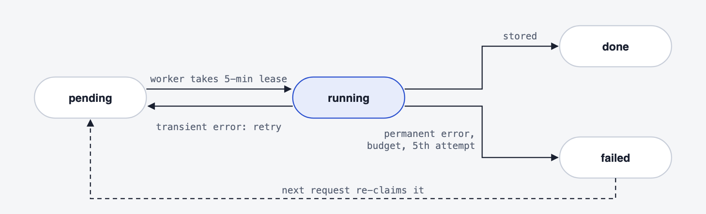
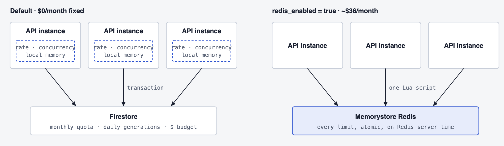
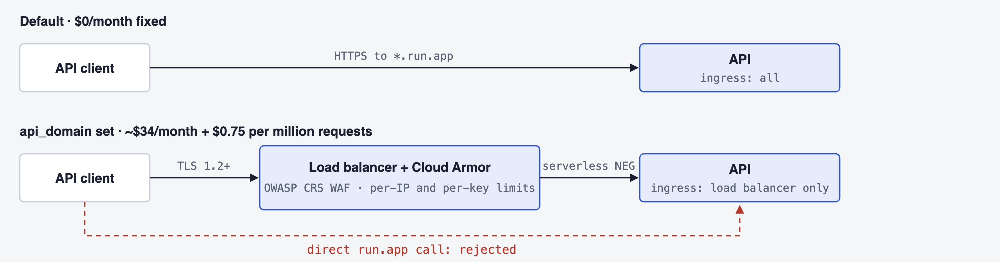
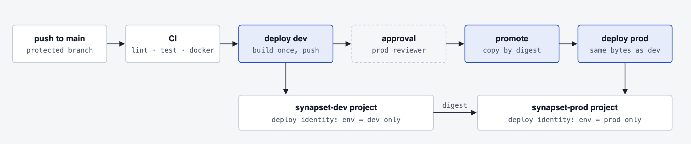

# Architecture

PNG diagrams rendered at 2x. When the architecture changes, update them in the same change as the code, so they stay in sync with the code they describe.

## System overview

Two Cloud Run services share one Firestore database. The public API answers from cache whenever it can. The internal worker is the only component that calls an LLM, and it is reached only through Pub/Sub. Orange marks the one paid path, the LLM call. Gemini serves for 5 minutes at a time whenever Anthropic reports billing, authentication or permission errors. Both services publish usage events, and BigQuery stores them for billing. Every checked question is also stored on its own in the `questions` bank, so later assessments can reuse it.

## Resolving a topic

The API tries the cheapest source first. The request is identified by its topic and context. After the cached-assessment lookups, it searches the question bank by meaning for each difficulty level. A question qualifies if its similarity clearly exceeds the request's noise floor (its similarity to unrelated questions). If the bank covers every level, the assessment is composed on the spot, with no LLM call and no charge. Otherwise the caller is charged one generation against its plan and the global daily budget, and the job carries the reused question IDs, so the worker generates only the gap. The charge is refunded if the job can't be enqueued. Searches are pre-filtered on a scope hash (locale, prompt version and embedding model, plus questions per level for whole assessments), so changing any of these never serves a stale format. Code: `packages/core/src/services/assessments.ts`, `packages/core/src/services/question-bank.ts`.

## Generation jobs

A job's ID is the topic's cache key, so concurrent misses for the same topic collapse into one LLM call. Pub/Sub delivers at least once, so the worker takes a lease before generating and acknowledges duplicates without calling the LLM. A pending or running job that hasn't changed in 15 minutes can be re-claimed. Code: `packages/core/src/services/generation.ts`.

## Limit stores

By default, the limits that protect money (the quotas and the dollar budget) are exact, stored in Firestore. The per-minute rate and the concurrency cap are kept in each instance's memory. Set `redis_enabled = true` once any account sustains about one request per second. See [Cost profile](../../README.md#cost-profile).

## Edge and ingress

Setting `api_domain` puts a global load balancer with Cloud Armor in front of the API, and Cloud Run ingress then rejects direct `run.app` calls. The WAF rules start in preview, logging only.

## Delivery

Dev deploys on every green CI run on `main`. After a reviewer approves the `prod` GitHub Environment, prod promotes dev's image by digest, without rebuilding it. Each project's deploy identity accepts only jobs running in its own GitHub Environment. Setup: [docs/setup.md](../setup.md).
